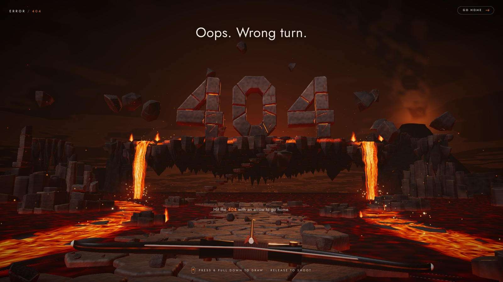

# THE LOST WORLD — interactive 3D 404



A single-page, real-time WebGL 404 experience. You stand on a broken stone
causeway in a sea of lava and look up at a floating island far ahead. On it
stands a monumental stone **404** with glowing cracks, and two lava falls pour
from its edges into the lake. Basalt formations and ruins frame the approach,
and a volcano smokes on the horizon. Everything is generated procedurally at
load: no 3D models and no textures, only code and custom GLSL.

The way out is a bow. Press, pull down to draw, and let go: **hit the 404
with an arrow** and the stone you hit shatters in slow motion, the monument
comes down as real rigid bodies, and the world burns away like old film to
the white home page.

```bash
npm install
npm run dev        # http://localhost:5173 (the 404), /home (where a hit takes you)
npm run build      # type-check + production bundle in dist/ (index.html + home.html)
npm run preview
```

Where "home" is lives in `src/config.ts` (`HOME_URL`). The demo ships its own
plain page at `/home`; on a real site you would point it at `/`.

Stack: React 19 · TypeScript · Vite 8 · three r186 · @react-three/fiber 9 ·
drei · @react-three/rapier (physics) · @react-three/postprocessing · d3-delaunay.

---

## Project map

```
home.html, src/home/           the white "You're now home" page
src/
  App.tsx, ui/Overlay.tsx      HTML UI: title in the sky, the goal above the arrow, pull hint, reticle; text burns off at the end
  ui/hud.ts                    HUD elements the scene drives every frame (the reticle, the goal's place)
  config.ts                    HOME_URL
  consoleFilters.ts            silences two known upstream deprecation notices
  debug.ts                     URL switches for profiling / inspection
  world/                       scene data and gameplay API, no React and no GPU
    layout.ts                  single source of truth: viewer, every placement, size, seed
    world.ts                   builds all procedural data once (getWorld())
    archery.ts                 ballistics, bow and game state, exact hit testing (BVH)
    finale.ts                  the winning shot's timeline: slow motion, the burn (shared with the page)
    time.ts                    world time vs real time (slow motion)
    gen/
      stoneField.ts            columnar basalt fields: causeway, island, formations, islets
      flowField.ts             baked lava velocity / heat / molten mask
      lavaFall.ts              fall ribbons from the island's river exits
      digits.ts                masonry glyphs for the 404
      fracture.ts              Voronoi fracture of closed meshes into closed pieces
      props.ts                 stairs, chunks, fragments, ruins, far lands
    events.ts                  typed world event bus
    navigation.ts              ground queries, waypoint graph, A*
    heat.ts                    heat sampling (matches what the shaders show)
    physics.ts                 collision groups, step and gravity
    interaction.ts, lavaLight.ts  shared pointer/shake state, light flashes, ripples
    index.ts                   public API barrel
  geometry/                    seeded RNG, CPU noise, polygons, beveled prism builder
  materials/
    rockMaterial.ts            the stylized stone (extends MeshStandardMaterial)
    lavaMaterial.ts            lake and island lava sheets, falls, glowing joints
    glsl/                      noise, lava model, colour ramp, atmosphere
    shared.ts                  uniforms shared by reference across all materials
    patchChunks.ts             replaces three's fog with the world's atmosphere
  scene/                       React Three Fiber components
    Experience.tsx             canvas, physics, quality tiers, ready signal
    TimeWarp.tsx               runs the frame clock at world speed
    Scene.tsx                  composition
    CameraRig.tsx              first-person framing, reveal, mouse look, shake
    Lighting.tsx, Sky.tsx, PostFX.tsx, Quality.tsx
    terrain/                   causeway, formations, stairs, far lands
    archery/                   the bow, arrows in flight, the win sequence (Victory.tsx)
    monument/                  the 404, and ruin.ts: its stones once they break loose
    fx/Burn.tsx                the impact shockwave and the burn to white (last post effect)
    island/ lava/ props/ fx/
```

## How it looks the way it does

**Composition.** The camera sits at eye height (1.62) on the causeway, 60 units
from the monument, and looks up at it. The title lives in the sky above
the monument, the goal sits just above the nocked arrow (the bow places it
there on any screen) and the bow is held low, so none of it ever covers the 404. Leading lines all point at the 404:
the path, two molten currents in the lake, and the floating stairs. The
island's underside stops well above the lava, so the glowing horizon shows
beneath it and the island visibly floats. The horizon directly behind it is
kept free of distant mesas for the same reason. On narrow screens the field
of view widens to keep the monument and both falls in frame, and portrait
screens lower the gaze slightly.

**Geometry.** Every stone surface is a *stone field*: a Voronoi tiling of a
jittered hex lattice in which each cell becomes a basalt column. Columns get
rounded three-segment bevels, rounded vertical corners, tapered or pointed
bases, and low-frequency displacement. Normals are face-weighted (the
hard-surface "weighted normals" trick), so large faces stay flat and only the
bevels shade softly. On the island, column depth grows toward the centre,
which forms an inverted mountain of stalactites. Cells are classified as
floor, rim, dais, river channel, source pool or bank, and that classification
drives heights, the lava and the physics.

**The 404.** Each digit is laid like real masonry: hand-designed glyph outlines
are cut into blocks (the 0 is a ring of voussoirs), extruded with bevels and
nudged slightly out of alignment. Thin emissive plates sit inside the joints,
so molten light leaks between the blocks. Ruins elsewhere deliberately avoid
glyph-like silhouettes such as arches, so nothing on the skyline reads as a
fourth character.

**Stone shading.** The procedural albedo layers broad patches, mottling and
strata with a per-stone tint. Up close, grain and vesicle pits fade in.
Bevel crests get patchy edge wear and there's derivative-based bump.
Fractures follow Voronoi borders; they taper at their ends and glow hottest
at the core, only where the stone is hot. Distant cracks fall back to a cheap
ridge-noise version. Lava light uses analytic capsule emitters, which give
orange bounce on undersides, falls and cliffs without dozens of dynamic
lights. Each material loops only over its own emitter group (island or
lake). Surfaces facing down also catch an uplight from the lake. Ambient
occlusion is baked into vertices: gaps between columns are probed against
their neighbours, and the ground darkens where the monument meets it.

**Lava.** Two baked flow fields hold velocity, heat and a molten mask: one
for the island's channels and source pool, one for the lake, where the falls
feed two molten currents toward the viewer. Two layers are flow-map advected:
a domain-warped core with streaks stretched along the current, and Voronoi
crust plates. Each plate is tied to its advection phase, so it forms, drifts
and stretches, then dissolves instead of cross-fading. Far lava switches to a
lighter shader. Falls are single ribbons that start upstream in the channel,
curl over the lip and plunge. Their flow coordinate is travel time, so the
surface accelerates smoothly and features stretch into streaks.

**The bow.** The bow is modelled in code: swept limbs with a softly squared
section, a bronze-fitted riser, a leather grip and an ember seam that flares
as you draw. It is held flat, like a slingshot, low in the frame, and every
part shares one shader program. The draw works like a slingshot too: pull
down and the shot climbs, pull right and it swings left. The further you
pull, the harder the arrow flies. The reticle is not a guess. Each frame the
drawn arrow's real ballistic path is traced against the real meshes (BVH
raycasts via three-mesh-bvh, plus the two lava planes), and the reticle sits
where it will land. It turns ember-red when that's the 404. Arrows in flight
follow the same path, sweeping a ray along every frame's segment, so they
can't tunnel and they land exactly where the reticle said. They burn like
fire arrows: a tracer trail and sparks in flight, then a glowing ember where
they stick. Stuck arrows quiver and ride along on what they knock. In lava
they sink with a splash. Threading the hole of the 0 counts as a bullseye,
and the arrow flies on through.

**Light and atmosphere.** A cool key light comes from over your left
shoulder with soft PCF shadows. It is backed by a warm rim light from behind
the island, a faint cool fill and a small environment for bevel sheen. Fog
and sky share one colour model, so distant rocks dissolve into exactly the
sky behind them, and smoke hangs low over the lake. The sky is a smoke
ceiling lit from beneath by the lava. A distant volcano adds an eruption
column with a glowing throat and billows lit from below. Post processing runs
heat shimmer, then HDR bloom (threshold 1.0, so only white-hot lava blooms),
then ACES, a light grade, vignette, the burn (idle until the end) and SMAA.

**The way home.** The winning shot plays out on one timeline
(`world/finale.ts`):

1. **The strike.** A 70 ms hit-stop, then slow motion (0.2×) that eases back
   to full speed over the next half second. `<TimeWarp />` scales the frame
   clock itself, so physics, shaders, particles and the camera all slow down
   together. Camera shake reads real time and stays a sharp jolt.
2. **The break.** The block the arrow struck is cut into 16 pieces around
   the point of impact: a Voronoi fracture of the real mesh, with seeds packed
   near the arrow. Each cell is the block clipped by bisecting planes, and
   every cut is capped, so pieces are closed solids that can break again.
   Their skin keeps the original stone's attributes, so the texture doesn't
   swim, while broken faces are hot inside. Those pieces glow red and trail
   embers as they arc out over the island's edge into the lake. The rest of
   the masonry comes loose as real rapier rigid bodies (convex hulls, drawn
   interpolated between physics steps), topples forward and lands in a heap
   with dust. Big stones that hit hard break again. Anything that reaches lava
   splashes, sinks and melts. Gravity on the stones is 1.8×, because at this
   size true gravity reads as floaty from where you stand.
3. **The cascade.** A wave of heat runs out from the struck digit, and each
   digit it reaches crumbles in turn. Threading the 0 bursts the whole ring
   outward instead.
4. **The burn.** Two seconds in, a hole burns open where the arrow struck.
   Its edge is ragged fbm, with a scorched band and char ahead of the flame
   line and ash lifting off it. It races out to the corners until only white
   is left. The page's text flares and burns off as the edge reaches it.
5. **Home.** The canvas is exactly white by then, so leaving for `/home`
   (prefetched at the hit) is seamless. There, the words settle in letter by
   letter.

Reduced motion keeps the collapse but drops the slow motion, the shake and
the camera push, and burns through faster.

## Interactions

| Do | What happens |
| --- | --- |
| Load the page | the view rises from the stones at your feet to the monument |
| Move the pointer | you look around a little and the view sways; embers and ash drift away from the cursor ray |
| Press and pull down | the goal above the arrow steps aside; the bow comes up and draws; the view leans into the shot and narrows; the reticle shows where the arrow will land and locks ember-red on the 404 (which trembles) |
| Let go | the arrow flies, trailing fire; the goal and the pull hint are gone for good |
| Hit the 404 | a beat of stillness and slow motion: the stone you hit shatters and its red-hot pieces arc into the lava, the digit topples, the others crumble in turn, then the world burns away from the point of impact and you arrive on the home page |
| Thread the 0 | the ring flares and bursts outward, the rest as above |
| Shoot anything else | arrows stick in stone and smoulder, knock floating stones and loose rocks flying (riding along with them), or sink into the lava with a splash |
| Tap without pulling | the goal comes back and the pull hint nudges you |
| Space (hold), arrow keys, release | the same, from the keyboard; Esc cancels |
| Point at a digit | it trembles, grit and embers shake loose, cracks and nearby lava heat up |
| Hover / click floating stones | they drift aside or tumble away, then spring home |
| Click loose rocks on the causeway | they get knocked away; rocks lost to the lava respawn after a few seconds |
| Click open lava | molten splash and ripple |
| Wait | pieces of the island's underside break off and plunge into the lake |

Every interaction recovers on its own, except the one that takes you home.
The **Go home** link in the corner is always there for anyone who would rather
not shoot.

## Performance

The scene starts on the **high** tier (DPR ≤ 1.25, SMAA) and a monitor adapts
from measured frame times. It steps down to medium (DPR ≤ 1.1) or low
(DPR ≤ 0.85, no SMAA) when frames run long. It climbs to **ultra** (DPR 1.5
plus screen-space AO) only when there is clear headroom.

Measured on an M3 Pro in headless Chrome at 1920×1080 and device pixel ratio
2, uncapped, on an otherwise idle machine:

- **High tier:** ~54 fps.
- **Medium tier:** ~63 fps, where the monitor settled during that run.

The bow costs nothing measurable: an A/B run with `?off=bow` came out within
1 fps. The finale runs without a single long frame at 1920×1080 (rAF and
long-task traces): fracturing a block takes about 2 ms, and the collapse is
some 50–80 convex bodies. While you draw, the reticle's flight trace runs every frame. A
bounding-sphere filter and the BVHs keep that well under a millisecond. The
BVHs are built one at a time in idle callbacks after load. The island and
causeway, the two big ones, take about 60 ms together.

The production build is interactive about 1.5 s after navigation. That
includes downloading the lazy 3D chunk, generating the whole world and
compiling shaders. Other measures that keep it fast:

- Particles are GPU-animated in a handful of draw calls.
- Geometry is merged per material.
- Islets cast no shadows.
- The page shell (UI and fonts) is a separate ~70 KB gzipped chunk.

## Building on it

**Archery.** Anything can become a target:

- `registerHittable({ mesh, surface, onHit })` makes a mesh something arrows
  strike. `surface` is `monument`, `stone` or `prop`; `moving: true` keeps its
  bounds fresh, and `passThrough: true` scores a hit without stopping the
  arrow.
- `sweep(a, b)` gives the first hit along a segment, and
  `predict(tip, velocity, out)` traces a whole flight.
- `bow` (aiming, draw, aim angles, which digit is locked) and `game` (won,
  where, when) are plain shared state.

**A character.** The world also has what a small walking character needs:

- **Physics.** The causeway, formations, island and stairs have fixed
  colliders (`GROUPS.walkable` or `GROUPS.solid`, in `world/physics.ts`). The
  digits use convex hulls, and debris and props have their own groups.
- **Navigation.** `groundAt(x, z, fromY?)` reports what is underfoot below a
  height (`stone`, `stairs`, `island`, `lava` or `void`) and the walking
  height. `getNavGraph()` and `findPath(a, b)` cover named, tagged waypoints:
  `start` → `causeway-*` → `landing` → `stair-*` → `island-edge` →
  `digit-0..2`. Causeway points close to the lava are tagged `hot`.
- **Heat.** `sampleHeat(position)` returns 0–1 from the same data the
  shaders use.
- **Events.** Subscribe through `worldEvents.on(...)` to `digit:strike`,
  `digit:proximity`, `debris:spawn`, `debris:melt`, `lava:splash`,
  `rock:knock`, `rock:lost`, `rock:respawn`, `fragment:knock`,
  `ambient:rockfall`, `bow:raise`, `bow:tap`, `arrow:fire`, `arrow:hit`,
  `monument:collapse`, `finale:burn` and `finale:done`.

**Breaking things.** `fracture(solid, seeds, { interior })` (in
`world/gen/fracture.ts`) breaks any closed triangle soup into closed pieces;
`scatterSeeds` places seeds inside it, optionally packed around a point.
`Ruin.spawn` (in `scene/monument/ruin.ts`) turns a piece into a rigid body
that splashes and melts in lava.

```ts
import { worldEvents, findPath, sampleHeat, groundAt } from './world'
worldEvents.on('digit:strike', ({ point }) => stickman.panic(point))
const route = findPath('start', 'digit-1')
```

## Development switches

Append to the URL:

- `?off=ao,bloom,smaa,haze,post,shadows,sky,far,atmos,particles,fire,sheet,falls,causeway,formations,island,monument,islets,rubble,bow`
  disables subsystems, for profiling or inspection.
- `?tier=0..3` forces the starting quality tier.
- `?tm=agx|aces|neutral` overrides tone mapping.
- `?cam=x,y,z&look=x,y,z` sets a free inspection camera.

In dev builds, `window.__LOST_WORLD__` exposes a few helpers for the console:
`shoot(x, y, z)` looses an arrow that lands on a world point (e.g.
`shoot(0, 22, -47.5)` hits the top of the 0), `project(x, y, z)` gives a world
point's position on screen, and `info()` reports draw calls and the quality tier.

## License

[MIT](LICENSE)
